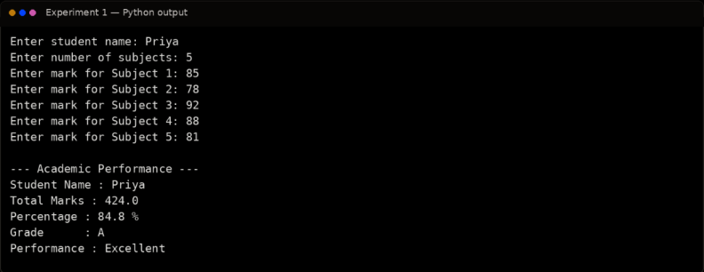

# Ex. No. 1 – Student Marks, Percentage, Grade and Academic Performance

## Aim
To develop a Python application that accepts student marks, calculates total marks, percentage and grade, and displays the academic performance using variables, operators, expressions, and input/output operations.

## Algorithm
1. Start the program.
2. Read the student's name and marks for the required subjects.
3. Calculate the total marks using arithmetic addition.
4. Calculate percentage using the total marks and maximum marks.
5. Determine the grade based on the percentage using conditional expressions.
6. Display the total, percentage, grade, and performance status.
7. Stop the program.

## Program
```python
# Student Marks, Percentage and Grade
name = input("Enter student name: ")
n = int(input("Enter number of subjects: "))
total = 0
for i in range(1, n + 1):
    mark = float(input(f"Enter mark for Subject {i}: "))
    total += mark
percentage = total / n

if percentage >= 90:
    grade = "A+"
    performance = "Outstanding"
elif percentage >= 80:
    grade = "A"
    performance = "Excellent"
elif percentage >= 70:
    grade = "B"
    performance = "Very Good"
elif percentage >= 60:
    grade = "C"
    performance = "Good"
elif percentage >= 50:
    grade = "D"
    performance = "Average"
else:
    grade = "F"
    performance = "Needs Improvement"

print("\n--- Academic Performance ---")
print("Student Name :", name)
print("Total Marks  :", total)
print("Percentage   :", round(percentage, 2), "%")
print("Grade        :", grade)
print("Performance  :", performance)
```

## Output


## Result
Thus, the Python application for calculating student marks, percentage, grade, and academic performance was implemented and executed successfully.
