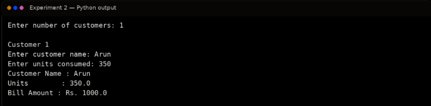

# Ex. No. 2 – Electricity Billing System Using Conditional Statements and Loops

## Aim
To develop a Python-based electricity billing system that calculates energy consumption charges using slab rates, conditional statements, and loops.

## Algorithm
1. Start the program.
2. Read the number of customers.
3. For each customer, read the customer's name and electricity units consumed.
4. Determine the applicable slab rates based on the units consumed.
5. Calculate the bill amount slab by slab.
6. Display the units and calculated bill amount.
7. Repeat for all customers and stop.

## Program
```python
# Electricity Billing System
def calculate_bill(units):
    bill = 0
    if units <= 100:
        bill = units * 1.50
    elif units <= 200:
        bill = 100 * 1.50 + (units - 100) * 2.50
    elif units <= 500:
        bill = (100 * 1.50) + (100 * 2.50) + (units - 200) * 4.00
    else:
        bill = (100 * 1.50) + (100 * 2.50) + (300 * 4.00) + (units - 500) * 6.00
    return bill

n = int(input("Enter number of customers: "))
for i in range(1, n + 1):
    print(f"\nCustomer {i}")
    name = input("Enter customer name: ")
    units = float(input("Enter units consumed: "))
    bill = calculate_bill(units)
    print("Customer Name :", name)
    print("Units         :", units)
    print("Bill Amount   : Rs.", round(bill, 2))
```

## Output


## Result
Thus, the electricity billing system using conditional statements, loops, and slab-based calculations was implemented and executed successfully.
