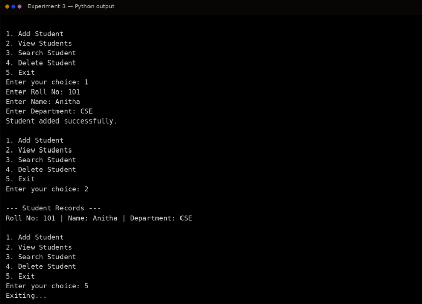

# Ex. No. 3 – Menu-Driven Student Information Management

## Aim
To implement a menu-driven Python application using functions and modular programming concepts to manage basic student information.

## Algorithm
1. Start the program.
2. Create an empty dictionary to store student records.
3. Define functions to add, view, search, and delete student records.
4. Display the menu repeatedly using a loop.
5. Read the user's choice.
6. Call the corresponding function based on the selected option.
7. Continue until the Exit option is selected.
8. Stop the program.

## Program
```python
# Menu-Driven Student Information System
students = {}

def add_student():
    roll = input("Enter Roll No: ")
    name = input("Enter Name: ")
    dept = input("Enter Department: ")
    students[roll] = {"Name": name, "Department": dept}
    print("Student added successfully.")

def view_students():
    if not students:
        print("No student records found.")
        return
    print("\n--- Student Records ---")
    for roll, data in students.items():
        print("Roll No:", roll,
              "| Name:", data["Name"],
              "| Department:", data["Department"])

def search_student():
    roll = input("Enter Roll No to search: ")
    if roll in students:
        print(students[roll])
    else:
        print("Student not found.")

def delete_student():
    roll = input("Enter Roll No to delete: ")
    if roll in students:
        del students[roll]
        print("Student deleted successfully.")
    else:
        print("Student not found.")

while True:
    print("\n1. Add Student")
    print("2. View Students")
    print("3. Search Student")
    print("4. Delete Student")
    print("5. Exit")
    choice = input("Enter your choice: ")
    if choice == "1":
        add_student()
    elif choice == "2":
        view_students()
    elif choice == "3":
        search_student()
    elif choice == "4":
        delete_student()
    elif choice == "5":
        print("Exiting...")
        break
    else:
        print("Invalid choice.")
```

## Output


## Result
Thus, a menu-driven student information management application using functions and modular programming concepts was implemented successfully.
