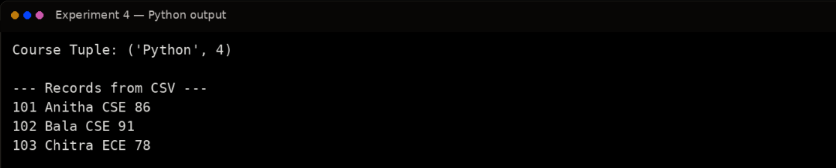

# Ex. No. 4 – Student Record Management Using Lists, Tuples, Dictionaries, Files and CSV

## Aim
To develop a student record management system using Python Lists, Tuples, Dictionaries, text file handling, and CSV file processing.

## Algorithm
1. Start the program.
2. Create student records using dictionaries and store them in a list.
3. Use tuples for fixed student information where appropriate.
4. Write the records to a text file.
5. Write the records to a CSV file using the csv module.
6. Read the CSV file and display the stored records.
7. Stop the program.

## Program
```python
# Student Record Management with List, Tuple, Dictionary and CSV
import csv

students = [
    {"RollNo": "101", "Name": "Anitha", "Department": "CSE", "Mark": 86},
    {"RollNo": "102", "Name": "Bala", "Department": "CSE", "Mark": 91},
    {"RollNo": "103", "Name": "Chitra", "Department": "ECE", "Mark": 78}
]

# Tuple example: fixed course details
course = ("Python", 4)
print("Course Tuple:", course)

# Write text file
with open("students.txt", "w") as file:
    for student in students:
        file.write(str(student) + "\n")

# Write CSV file
with open("students.csv", "w", newline="") as file:
    fields = ["RollNo", "Name", "Department", "Mark"]
    writer = csv.DictWriter(file, fieldnames=fields)
    writer.writeheader()
    writer.writerows(students)

# Read CSV file
print("\n--- Records from CSV ---")
with open("students.csv", "r") as file:
    reader = csv.DictReader(file)
    for row in reader:
        print(row["RollNo"], row["Name"],
              row["Department"], row["Mark"])
```

## Output


## Result
Thus, a student record management system using Lists, Tuples, Dictionaries, File Handling, and CSV processing was implemented successfully.
